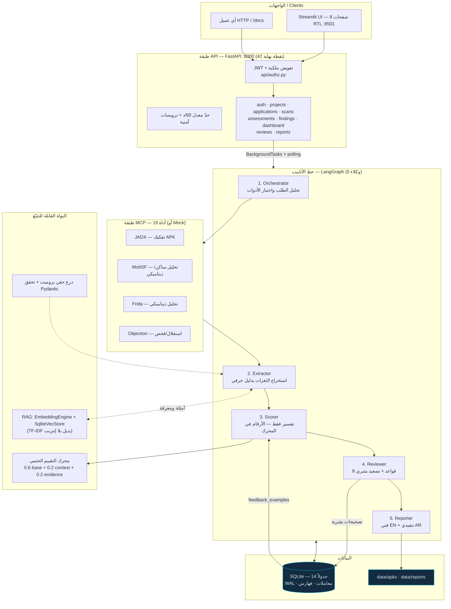

<p align="center">
  
</p>

<h1 align="center">Android Vulnerability Severity MAS</h1>
<p align="center"><em>Multi-Agent Vulnerability Severity Assessment for Android Applications — OWASP MASVS aligned</em></p>

<p align="center">
  
  
  
  
  
  
  
  
</p>

---

## 📑 جدول المحتويات

| # | القسم | # | القسم |
|---|---|---|---|
| 1 | [نظرة عامة](#-نظرة-عامة) | 8 | [منطق التقييم](#-منطق-التقييم) |
| 2 | [الميزات الرئيسية](#-الميزات-الرئيسية) | 9 | [هيكل المشروع](#-هيكل-المشروع) |
| 3 | [البنية المعمارية](#-البنية-المعمارية) | 10 | [المطوّر](#-المطوّر) |
| 4 | [التثبيت السريع](#-التثبيت-السريع) | 11 | [الترخيص](#-الترخيص) |
| 5 | [الاستخدام](#-الاستخدام) | 12 | [الاقتباس](#-الاقتباس) |
| 6 | [الاختبارات](#-الاختبارات) | 13 | [شكر وتقدير](#-شكر-وتقدير) |
| 7 | [البنية التقنية](#-البنية-التقنية) | 14 | [إخلاء المسؤولية](#-إخلاء-المسؤولية) |

---

## 📋 نظرة عامة

نظام **متعدد الوكلاء (5 وكلاء)** يقيّم خطورة ثغرات تطبيقات أندرويد وفق **OWASP MASVS**،
من رفع ملف APK إلى تقريرين جاهزين (فني إنجليزي وتنفيذي عربي) في ست صيغ. الفرق الجوهري
عن أنظمة «الصندوق الأسود»: **كل رقم قابل للتتبّع** إلى معادلة في الكود أو صف في قاعدة
البيانات، وكل قرار تصميمي موثّق، و**لا يُنشر أي رقم جودة قبل تعبئة الحقيقة المرجعية يدوياً** —
النظام مهندَس ليقول «غير معلوم» بدل أن يخمّن.

> **يعمل بلا إنترنت وبلا مفاتيح:** `LLM_MOCK_MODE=1 MCP_MOCK_MODE=1 EMBEDDING_MOCK_MODE=1`
> تشغّل النظام كاملاً بمخرجات حتمية — للعروض الأكاديمية والاختبارات المتكرّرة.

## ✨ الميزات الرئيسية

1. **خط أنابيب LangGraph من 5 وكلاء** — منسّق → مستخرج → مُقيّم → مراجع → مُقرِّر،
   مع حفظ حالة قابل للاستئناف (`AsyncSqliteSaver`) وبصمة إعادة تشغيل.
2. **معادلة خطورة شفّافة** `final = 0.6·base + 0.2·context + 0.2·evidence` مع نشر
   المكوّنات كاملة (`base_score`, `context_score`, `evidence_score`, `confidence_factor`) وتفسير عربي.
3. **النموذج اللغوي لا يحسب** — الأرقام تُحسب حتمياً في الكود، والنموذج ينسخها ويكتب
   التفسير فقط: قابلية تدقيق كاملة وإعادة إنتاج حرفية.
4. **مراجعة آلية بثماني قواعد صريحة** في الكود + ثلاثة معايير حتمية للتصعيد البشري
   (ثقة منخفضة · منطقة حدّية · Critical هشّ).
5. **حلقة مراجعة بشرية ذاتية التغذية (HITL)** — كل تصحيح بشري يولّد `feedback_examples`
   تُستخدم كأمثلة قليلة (Few-Shot) لاحقاً، و`final_score` **لا يُمَس أبداً**.
6. **طبقة RAG تعمل بلا إنترنت** — أربع خلفيات تضمين مع تراجع تلقائي إلى TF-IDF
   **مسجَّل السبب** (`fallback_reason`)، ومخزن متجهات على SQLite (`sqlite-vec`).
7. **تصليب أمني كامل (المرحلة 8)** — JWT، **تفويض ملكية** على سلسلة الموارد، حدّ معدل،
   ترويسات أمنية على كل استجابة (بما فيها 500)، تحقّق أسرار عند الإقلاع، درع حقن برومبت.
8. **API كاملة (42 نقطة نهاية)** بعقد `response_model` لكل نقطة وصيغة أخطاء موحّدة
   `{detail, error}`، وتوثيق تفاعلي على `/docs`.
9. **واجهة عربية RTL (8 صفحات)** بـ Streamlit: لوحة KPI، مشاريع، رفع وفحص، ثغرات،
   تفاصيل تقييم، مراجعة، تقارير، وتحليل تجربة.
10. **قياس وتقييم صارم** — 331 اختباراً (وحدة · تكامل · شمول · فوضى · أمن)، مقاييس
    إحصائية مُنفَّذة يدوياً (Weighted κ، Gwet AC1، بووتستراب 10,000/بذرة 42)، ونشر كامل
    للحاويات والأطروحة.

## 🏗️ البنية المعمارية



**تدفّق مختصر:** يرفع المستخدم APK → تُنشأ مهمة خلفية → المنسّق يخطّط ويشغّل الأدوات →
المستخرج يبني ثغرات مؤدَّلة بحقن-دروع ومعزولة بوسوم → المُقيّم يطبّق المعادلة **حتمياً**
ويكتب التفسير → المراجع يطبّق القواعد الثمانية ويقرّر التصعيد → تُخزَّن كل المكوّنات →
المُقرِّر يولّد تقريرين بست صيغ. **والثابت:** `final_score` لا يُمَس بعد الحساب، لا
بمراجعة آلية ولا بشرية.

## 🚀 التثبيت السريع

### عبر Docker (موصى به)

```bash
git clone https://github.com/ko456123mo-jpg/android-vuln-severity-mas.git
cd android-vuln-severity-mas
cp .env.example .env            # للتجربة: MAS_ENV=development + أوضاع Mock
docker compose build            # أو: make docker-build
docker compose up -d            # أو: make docker-up
```

| الخدمة | الرابط | ملاحظة |
|---|---|---|
| الواجهة (Streamlit عربية) | http://localhost:8501 | يبدأ بتسجيل الدخول |
| الـ API والتوثيق | http://localhost:8000/docs | 42 نقطة نهاية |
| فحص الصحة | http://localhost:8000/health | `status: ok` |
| MobSF | داخلي فقط (تعمُّد أمني) | للفتح المحلي: `INSTALL_DOCKER.md` §5 |

**بيانات الدخول التجريبية:** `admin` / `admin123` — ⚠️ **غيّرها فوراً** قبل أي استخدام غير محلي.
الدليل الكامل (متطلبات، خدمات، أخطاء شائعة 16 حالة، قياسات، قائمة تحقق):
**[`INSTALL_DOCKER.md`](INSTALL_DOCKER.md)**.

### يدوياً (Python 3.11+)

```bash
python -m venv .venv && source .venv/bin/activate
pip install -e .
cp .env.example .env
make init-all                   # مخطط + بذر + فهرسة RAG
make run-api                    # ‎:8000
make run-ui                     # ‎:8501 (نافذة أخرى)
```

للتشغيل بلا مفاتيح ولا إنترنت: صدّر `LLM_MOCK_MODE=1 MCP_MOCK_MODE=1 EMBEDDING_MOCK_MODE=1`
(أو استخدم `make test`).

## 📖 الاستخدام

**1) عبر الواجهة العربية (8 صفحات):** سجّل الدخول → أنشئ مشروعاً → ارفع APK → ابدأ فحصاً
→ تابع الحالة → راجع الثغرات والتقييمات → صحّح ما يلزم → نزّل التقارير.

**2) عبر الـ API — من الرفع إلى التقرير:**

```bash
# ① دخول
TOKEN=$(curl -s -X POST http://localhost:8000/auth/login \
  -H 'Content-Type: application/json' \
  -d '{"username":"admin","password":"admin123"}' | python -c "import sys,json;print(json.load(sys.stdin)['access_token'])")

# ② مشروع + رفع APK (بصمة SHA-256 تلقائية، وتكرار داخل المشروع يُكتشف)
PROJECT=$(curl -s -X POST http://localhost:8000/projects -H "Authorization: Bearer $TOKEN" \
  -H 'Content-Type: application/json' -d '{"name":"تجربة","description":"فحص أول"}' \
  | python -c "import sys,json;print(json.load(sys.stdin)['id'])")

APP=$(curl -s -X POST http://localhost:8000/applications/upload -H "Authorization: Bearer $TOKEN" \
  -F project_id=$PROJECT -F name="Demo" -F file=@demo.apk \
  | python -c "import sys,json;print(json.load(sys.stdin)['application']['id'])")

# ③ فحص شامل (مهمة خلفية — راقب بالاستقصاء)
SCAN=$(curl -s -X POST http://localhost:8000/scans/start -H "Authorization: Bearer $TOKEN" \
  -H 'Content-Type: application/json' -d "{\"application_id\":$APP,\"scan_type\":\"comprehensive\"}" \
  | python -c "import sys,json;print(json.load(sys.stdin)['scan_id'])")
curl -s -H "Authorization: Bearer $TOKEN" http://localhost:8000/scans/$SCAN/status

# ④ تصحيح بشري (يُولّد مثال تغذية راجعة — و final_score لا يتغيّر)
curl -s -X POST http://localhost:8000/reviews/1/correct -H "Authorization: Bearer $TOKEN" \
  -H 'Content-Type: application/json' \
  -d '{"corrected_severity":"Critical","corrected_score":9.4,"reason":"مراجعة خبير بعد تحقق يدوي من الأثر"}'

# ⑤ تقرير PDF عربي تنفيذي (صيغ: technical_md|executive_md|technical_html|executive_html|technical_pdf|executive_pdf)
curl -s -X POST http://localhost:8000/reports/generate -H "Authorization: Bearer $TOKEN" \
  -H 'Content-Type: application/json' -d "{\"scan_id\":$SCAN,\"format\":\"executive_pdf\"}"
```

**3) تجربة القياس بأربعة أوضاع** (بلا نتائج مُختلقة — يرفض النشر قبل تعبئة الحقيقة المرجعية):

```bash
python evaluation/run_experiment.py --mode full      --apps diva          # كامل
python evaluation/run_experiment.py --mode scorer_only --apps diva        # RQ3
python evaluation/run_experiment.py --mode no_rag      --apps diva        # RQ4
python evaluation/run_experiment.py --mode no_feedback --apps diva        # RQ5
```

**4) قياس الأداء والفحص النهائي:**

```bash
python scripts/benchmark.py            # 7 محاور → results/benchmark.md
python scripts/load_test.py            # p50/p95/p99 → results/load_test.md
python scripts/final_checklist.py      # 13 بنداً → results/final_checklist.md
python scripts/make_release.py         # حزمة الإصدار + بصمة SHA-256
```

## 🧪 الاختبارات

```
331 passed in 62.91s        python -m pytest tests -q        (وضع Mock — بلا شبكة)
```

| المجموعة | العدد | ما تتحقق منه |
|---|---|---|
| `tests/unit` | **260** | التقييم · القواعد الثمانية · المستخرج · المدققون · المقيّم · RAG · المقاييس · المصادقة · حِزم الواجهة |
| `tests/integration` | **20** | خط الأنابيب كاملاً · التقارير · واجهة Streamlit (فحوص دخان) |
| `tests/e2e` | **2** | سيناريو شامل عبر الـ API: رفع → فحص → مراجعة → 6 صيغ تقارير |
| `tests/chaos` | **11** | فشل الأدوات · انقطاع المزوّد · قفل القاعدة · تدهور رشيق |
| `tests/security` | **38** | توكن منتهٍ/مزوّر/alg=none · حدّ معدل · اجتياز مسارات · 409 بلا تسريب · SQLi · حقن برومبت · تفويض · ترويسات · أسرار الإقلاع |

```bash
make test                       # كل الاختبارات (Mock)
make test-e2e                   # شمول + فوضى + أمن
pytest tests -q -k "security"   # مجموعة بعينها
```

## 🛠️ البنية التقنية

| الطبقة | التقنية | لماذا اختيرت |
|---|---|---|
| تنظيم الوكلاء | **LangGraph** + AsyncSqliteSaver | نقاط تحقّق واستئناف، وحدود عقد واضحة |
| النماذج اللغوية | Groq / Gemini / Anthropic / Ollama | تعدد مزوّدين مع تسلسل محاولات ووضع Mock حتمي |
| أدوات الفحص | **MCP** موحّد: JADX · MobSF · Frida · Objection | 19 أداة بعقد واحد وتسجيل كل نداء |
| الـ API | **FastAPI** + SQLAlchemy 2 | عقود Pydantic صريحة، توثيق تلقائي، مهام خلفية |
| الواجهة | **Streamlit** (8 صفحات، RTL) | تسليم عربي سريع بلا بناء SPA |
| قاعدة البيانات | **SQLite (WAL)** — 14 جدولاً | صفر إعداد + ملف واحد للنسخ الاحتياطي |
| الاسترجاع المعرفي | sqlite-vec + 4 خلفيات تضمين + TF-IDF | يعمل **بلا إنترنت** بجودة مثبّتة كاختبار انحدار |
| التقارير | Jinja2 + **WeasyPrint** (PDF) | قوالب مستقلة عن المنطق، وRTL صحيح |
| الأمن | JWT · تفويض ملكية · حدّ معدل · ترويسات · تحقق أسرار | كل ضبط له اختبار |
| النشر | Docker multi-stage (غير جذري) + Compose | تصغير السطح + فحوص صحة لكل خدمة |
| الاختبار | Pytest 331 اختباراً + فوضى + أمن | جودة قابلة للتشغيل بأمر واحد |

## 📊 منطق التقييم

```
final_score    = 0.6·base_score + 0.2·context_score + 0.2·evidence_score
evidence_score = 3.0 + 7.0·confidence_factor
confidence     = 0.4·tool_count + 0.3·evidence_quality + 0.2·tool_reliability + 0.1·reproducibility
```

| الفئة (MASVS) | الوزن `base` |
|---|---|
| `MASVS-CRYPTO` | 9.0 |
| `MASVS-STORAGE` | 8.0 |
| `MASVS-NETWORK` | 7.5 |
| `MASVS-AUTH` | 7.0 |
| `MASVS-PLATFORM` | 6.0 |
| `MASVS-RESILIENCE` | 5.0 |
| `MASVS-CODE` | 4.0 |
| غير معروفة | 5.0 (وسط المدى — صراحةً) |

**الفئات:** Critical ≥ 9.0 · High ≥ 7.0 · Medium ≥ 4.0 · Low ما دونها.

**مثال حقيقي من المحرك** (مفتاح AES صلب في الكود، رصدته أداتان ومؤكَّد ديناميكياً، سياق مرتفع):
`base 9.0` · `context 10.0` · `confidence 0.845` · `evidence 8.915` ⇒
**`final = 9.183` → Critical**، ويُصعَّد للمراجعة البشرية تلقائياً (منطقة حدّية 0.183 ≤ 0.5
و Critical بثقة 0.845 < 0.9). التفاصيل والقواعد الثمانية والحدود المعروفة:
**[`docs/scoring_logic.md`](docs/scoring_logic.md)** و**[`docs/thesis/appendix_b_rules.md`](docs/thesis/appendix_b_rules.md)**.

> **إفصاح علمي:** تحليل شمولية (144 تركيبة) يُظهر أن المدى الفعلي للدرجات
> **[4.68 … 9.34]** وأن فئة `Low` غير قابلة للوصول في إصدار القاعدة الحالي، وأن قواعد
> المراجعة الثمانية **خامدة** بنيوياً — كل ذلك **مُقاس ومُعلَن** مع خطة معايرة v2 في
> [`results/reachability.md`](results/reachability.md) و[`docs/thesis/limitations_and_future_work.md`](docs/thesis/limitations_and_future_work.md).

## 📁 هيكل المشروع

```
android-vuln-severity-mas/
├── agents/          (22 ملفاً)  الوكلاء الخمسة · 7 قوالب برومبت Jinja2 · عميل MCP · القواعد الثمانية
├── api/             (17 ملفاً)  FastAPI: 9 موجّهات (42 نقطة نهاية) · التفويض · المصادقة · المخططات
├── assets/logo/     (20 ملفاً)  الهوية البصرية: SVG/PNG/ICO + BRAND_GUIDE + preview + اللوحة
├── config/          (3 ملفات)   الإعدادات: models · tools · settings (+ severity rules في القاعدة)
├── core/            (28 ملفاً)  التقييم · الحماية من الحقن · الأمن · الأداء · التقارير · التغذية الراجعة
├── db/              (14 ملفاً)  14 جدولاً · مستودعات · بذر · ترحيلات
├── docs/            (44 ملفاً)  الأطروحة (5 ملاحق + 5 مخططات + الشعار) · API · الأمن · النشر · الأدلة
├── evaluation/      (21 ملفاً)  بروتوكول 4 أوضاع · المقاييس الإحصائية · 12 تطبيقاً + قوالب GT
├── mcp_servers/     (25 ملفاً)  4 خوادم MCP: jadx · mobsf · frida · objection
├── rag/             (5 ملفات)   EmbeddingEngine · SqliteVecStore · Retriever · Ingest
├── scripts/         (18 ملفاً)  init/seed · benchmark · load_test · final_checklist · make_release · build_logo
├── tests/           (21 ملفاً)  331 اختباراً: unit · integration · e2e · chaos · security
├── ui/streamlit_app/(16 ملفاً)  الواجهة العربية RTL: app + 8 صفحات + i18n + عميل API
├── Dockerfile.api · Dockerfile.ui · docker-compose.yml · Makefile · .env.example
├── INSTALL_DOCKER.md · CHANGELOG.md · CITATION.cff · LICENSE · VERSION · README.md
```

## 👨‍💻 المطوّر

**المهندس محمد منير** — Engineer Mohammed Moneer

- 📧 [moh123mon456@gmail.com](mailto:moh123mon456@gmail.com)
- 🐙 [@ko456123mo-jpg](https://github.com/ko456123mo-jpg)
- 📦 [android-vuln-severity-mas](https://github.com/ko456123mo-jpg/android-vuln-severity-mas)

مشروع تخرّج أكاديمي: **تصميم وتنفيذ نظام متعدد الوكلاء لتقييم خطورة ثغرات تطبيقات
أندرويد وفق OWASP MASVS** — مع بروتوكول تقييم إحصائي ومواد أطروحة كاملة.

## 📜 الترخيص

**MIT License** — Copyright (c) 2026 **Engineer Mohammed Moneer** <moh123mon456@gmail.com>
انظر [`LICENSE`](LICENSE). تراخيص الأدوات الخارجية (JADX · MobSF · Frida · Objection)
تبقى لأصحابها ولا تُحزَّم مع هذا المستودع.

## 📚 الاقتباس

```bibtex
@software{android_vuln_severity_mas_2026,
  title        = {Android Vulnerability Severity MAS — Multi-Agent System for
                  Android Vulnerability Severity Assessment},
  author       = {Moneer, Mohammed},
  year         = {2026},
  version      = {1.0.0},
  license      = {MIT},
  url          = {https://github.com/ko456123mo-jpg/android-vuln-severity-mas},
  note         = {OWASP MASVS-aligned; HITL feedback loop; reproducible evaluation protocol}
}
```

ملف الاستشهاد الكامل (CFF 1.2.0): [`CITATION.cff`](CITATION.cff).

## 🙏 شكر وتقدير

- **المشرف الأكاديمي** على التوجيه المنهجي ومتابعة مراحل المشروع الثماني.
- **فريق التطوير** على المراجعات والأسئلة التي كشفت عيوباً حقيقية قبل النشر.
- **مجتمع المصادر المفتوحة:** OWASP (MASVS/MASTG) · JADX · MobSF · Frida · Objection ·
  LangGraph/LangChain · FastAPI · Streamlit · sqlite-vec — بلا هذه الأدوات ما كان
  هذا النظام ممكناً.
- كل من ساهم في المراجعة الأمنية أو تقييم الحقيقة المرجعية (قيد الإنجاز — يعطّل نشر
  أي رقم جودة عن قصد حتى يكتمل).

## ⚠️ إخلاء المسؤولية

هذا المشروع **للأغراض الأكاديمية والدفاعية**. استخدمه فقط على تطبيقات **تملك صلاحية
تحليلها**. الأنظمة داخل الحاويات (MobSF/Frida/Objection) يجب ألا تُعرَّض للإنترنت —
التصميم يمنع ذلك افتراضياً (الخدمة داخلية بلا منفذ منشور). المطوّر غير مسؤول عن أي
استخدام مخالف للقانون أو للاتفاقيات.

---

<p align="center">
  <sub><b>331 اختباراً ناجحاً · 42 نقطة نهاية · 14 جدولاً · 5 وكلاء · 8 مراحل · الإصدار 1.0.0</b></sub><br/>
  <sub>© 2026 Engineer Mohammed Moneer — MIT · <a href="assets/logo/BRAND_GUIDE.md">دليل الهوية البصرية</a></sub>
</p>
